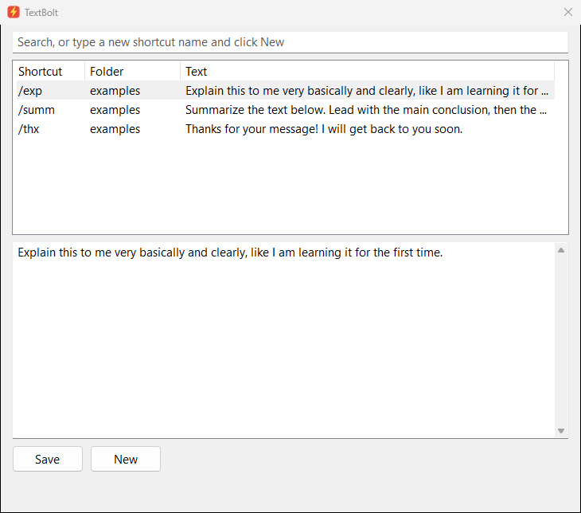

# TextBolt ⚡

A tiny, free text expander for Windows. Type a shortcut like `/thx` anywhere and it instantly turns into your saved text.

I built it to replace Text Blaze, which caps snippets on its free plan and used about 560 MB of RAM on my PC. TextBolt is one ~200-line [AutoHotkey](https://www.autohotkey.com/) script that uses about 3 MB.

## Install

1. Install [AutoHotkey v2](https://www.autohotkey.com/) (free).
2. Download this repo (green **Code** button → **Download ZIP**) and unzip it anywhere.
3. Double-click `textbolt.ahk`. A lightning-bolt icon appears in your system tray.
4. Try it: type `/thx` in any text box.

**Start it with Windows:** press `Win+R`, type `shell:startup`, press Enter, and put a shortcut to `textbolt.ahk` in that folder.

## Use it

- **Expand:** type `/` plus a snippet's name. It works in any app: browsers, chat apps, editors.
- **Search, edit, add:** left-click the tray icon or press **Ctrl+Shift+Space**.
  - Type to filter. Press **Enter** or double-click a snippet to insert it where you were typing.
  - The box at the bottom shows the selected snippet. Edit it and press **Ctrl+S** (or Save). Switching snippets or closing the window also saves.
  - **New:** type a new shortcut name in the search box (e.g. `hello`), click **New**, then type its text below. `/hello` works right away.
- **Tray menu** (right-click the icon): Search, Open snippets folder, Pause, Reload, Exit.

## How snippets are stored

Every snippet is a plain text file: `snippets/<folder>/<name>.txt` becomes `/<name>`. Folders are only for organizing. You can edit the files in any editor too; TextBolt reloads within about 2 seconds. Your own snippets are git-ignored, so they never get uploaded if you fork this.

## Good to know

- **Shortcuts fire the instant you finish typing them**, even right after other text (like Text Blaze). So don't make one shortcut the start of another: with `/sum` and `/summary`, `/sum` would always win.
- **Text goes in by pasting.** That's what makes long snippets instant and keeps emoji and special characters intact. Your clipboard is restored half a second later.
- **Plain text only.** No rich formatting, forms, or variables. If you need those, Text Blaze or [Espanso](https://espanso.org/) are great.

## License

MIT. Use it, change it, share it.
